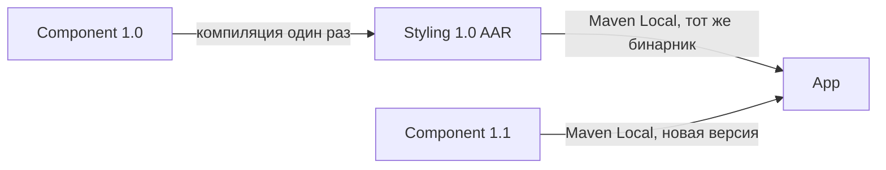

# Бинарная совместимость: Component 1.0 и 1.1

## Полученный результат

Component 1.1 сохраняет проверенные бинарные вызовы обоих контрактов из Styling 1.0.
Styling не перекомпилировался и не перепубликовывался при переходе на 1.1. Его AAR,
classes.jar, sources.jar, POM и Gradle Module Metadata совпадают побайтово между этапами.

Отдельный пример с `@JvmOverloads` воспроизводит `NoSuchMethodError` при вызове старого
`$default`. Аналогичная функция с `@IntroducedAt("1.1")` сохраняет этот вызов.
Контракты исправлены явными скрытыми overloads; контрольная ошибка относится к отдельной
функции, а не к контрактам.

| Проверка App против замороженного Styling | Component 1.0 | Component 1.1 |
| --- | --- | --- |
| Contract1: фабрика с defaults и со всеми аргументами | Проходит | Проходит |
| Contract1: copy с defaults и со всеми аргументами | Проходит | Проходит |
| Contract1: rememberCopy и composable preset | Проходит | Проходит |
| Contract2: фабрика с defaults и со всеми аргументами | Проходит | Проходит |
| Contract2: copy с defaults и со всеми аргументами | Проходит | Проходит |
| Contract2.Contract: конструктор с defaults и со всеми аргументами | Проходит | Проходит |
| Contract2: composable preset | Проходит | Проходит |
| Старый copy сохраняет новый callback borderStroke у Contract2 | Пропущено: метода ещё нет | Проходит |
| withJvmOverloads: старый вызов со всеми аргументами | Проходит | Проходит |
| withJvmOverloads: старый вызов с пропущенным optional | Проходит | NoSuchMethodError |
| withIntroducedAt: оба старых способа вызова | Проходят | Проходят |
| Итого | 17 passed, 1 skipped | 17 passed, 1 failed |

Все 13 старых проверок контрактов проходят на обоих этапах. Дополнительная проверка нового
callback проходит на 1.1. Контрольные две функции дают ещё четыре проверки.

Оригинальные результаты: [1.0 JUnit XML](../artifacts/1.0/test-results/app/TEST-com.alexcawl.contract.playground.app.BinaryCompatibilityTest.xml),
[1.1 JUnit XML](../artifacts/1.1/test-results/app/TEST-com.alexcawl.contract.playground.app.BinaryCompatibilityTest.xml).

## Как исключили перекомпиляцию Styling



- `codex/contract-1.0`: сначала публикуется `com.alexcawl.contract.playground:component:1.0`,
  затем `com.alexcawl.contract.playground:styling:1.0`.
- Styling зависит от Maven-координат Component **1.0**. В его POM и `.module` записана эта версия.
- `codex/contract-1.1`: публикуется только `component:1.1`. Публикация `styling:1.0` не запускается.
- App явно выбирает Component **1.1** и Styling **1.0**. Gradle повышает транзитивную зависимость
  `component:1.0` до `component:1.1`; `project(...)` dependencies отсутствуют.
- Исходники и настройки `styling` и `app` идентичны в двух ветках. У App перекомпилируется
  проверяющий код против выбранной зависимости; старые вызовы находятся внутри неизменного Styling.

SHA-256 опубликованного Styling AAR на обоих этапах:

```text
c7beae984b0dabaf3dfee842a6194e47306448ff1e2e6ba0eb9cdd4bea3a41df
```

Доказательства: [manifest 1.0](../artifacts/1.0/manifest.json), [manifest 1.1](../artifacts/1.1/manifest.json),
[POM Styling](../artifacts/1.1/maven/styling/1.0/styling-1.0.pom),
[dependency graph 1.1](../artifacts/1.1/logs/dependencies.log),
[dependencyInsight 1.1](../artifacts/1.1/logs/component-resolution.log).
В [логе App 1.1](../artifacts/1.1/logs/app-verification.log) нет задач компиляции Component/Styling:
App потребляет опубликованные AAR.

## Какие сигнатуры изменились у контрактов

В 1.0 у интерфейсов есть обязательный `cornerSize(): Dp` и default `shape(): Shape`,
который возвращает `RoundedCornerShape(cornerSize())`. В 1.1 добавляется default
`borderStroke(): BorderStroke? = null`. Тела старых методов сохранены.

| Объявление | API 1.0 | Новый API 1.1 | Сохранённый путь 1.0 в 1.1 |
| --- | --- | --- | --- |
| Contract1 factory | cornerSize, shape = null | cornerSize, shape = null, borderStroke = null | Hidden factory с прежними параметрами и default shape |
| Contract1.copy | cornerSize = wrapped.cornerSize, shape = wrapped.shape | Те же callbacks и borderStroke = wrapped.borderStroke | Hidden copy с прежними defaults |
| Contract1.rememberCopy | Два callbacks, Composer и маски после lowering | Три callbacks, Composer и маски | Hidden composable overload прежней арности |
| Contract2.Contract | cornerSize, shape = null | cornerSize, shape = null, borderStroke = null | Hidden secondary constructor с прежним default shape |
| Contract2 factory | cornerSize, shape = null | cornerSize, shape = null, borderStroke = null | Hidden factory с прежним default shape |
| Contract2.copy | cornerSize = null, shape = null | cornerSize = null, shape = null, borderStroke = null | Hidden copy с прежними defaults |
| Contract2Impl | Два хранимых callbacks | Три callbacks и override borderStroke | Старый private constructor не сохраняется |

Эта таблица объясняет изменение параметров. **Полные типы, объявления исходников, JVM-имена,
все descriptors, конструкторы и default helpers приведены без сокращений в
[API_SIGNATURES.md](API_SIGNATURES.md).** Исходники там извлечены из оригинальных опубликованных
sources.jar; JVM-часть взята из оригинального `javap -p -s`.

`@Composable` меняет JVM-форму V1: callbacks используют `kotlin.jvm.functions.Function3`,
включая Composer и changed mask. Обычные callbacks V2 используют Function1. Возвращаемый Dp
разворачивается в float в методах интерфейсов; JVM-имена методов cornerSize имеют mangling.
У composable `rememberCopy` default mask входит в lowered signature; отдельный `$default`
для этого метода не создаётся. У обычных фабрик/copy `$default` создаётся.

Сравнение [public-methods.json](../artifacts/diffs/public-methods.json) проверяет сохранение
каждого public/protected method descriptor старых интерфейсов, фасадов фабрик/copy, Wrapper,
DefaultImpls и Contract2.Contract. В этих классах удалённых методов **нет**. Private Kotlin
implementation показан отдельно: изменение его конструктора разрешено. Это проверка перечисленных
API-классов; compiler-generated anonymous implementation classes не объявляются стабильным API.

## Почему secondary constructor недостаточно

Старый `Contract2.Contract` конструктор имеет два callbacks. Новый primary constructor имеет
три. Deprecated secondary constructor принимает прежние два и передаёт `null` для нового поля:

```kotlin
@Deprecated("Binary compatibility with 1.0", level = DeprecationLevel.HIDDEN)
constructor(
    cornerSize: Contract2.() -> Dp,
    shape: (Contract2.() -> Shape)? = null,
) : this(cornerSize, shape, null)
```

Сохранён именно default `shape = null`. Поэтому компилятор оставляет и старый обычный constructor,
и старый synthetic constructor с default mask и DefaultConstructorMarker. Оба пути проверены
вызовами из старого Styling.

Конструктор контейнера не сохраняет методы фасада `Contract2Kt`. Для фабрики и extension copy
нужны самостоятельные старые overloads. У них также сохранены исходные default-аргументы;
компилятор создаёт старые `Contract2$default` и `copy$default` рядом с новыми.
`DeprecationLevel.HIDDEN` прячет legacy API от нового Kotlin-кода, сохраняя JVM-точки входа.

Старый copy делегирует в новый copy с `borderStroke = null`. Новый copy интерпретирует null как
«сохранить callback из snapshot», а не «стереть callback». Поэтому даже вызов из старого Styling
сохраняет новый borderStroke у экземпляра 1.1; это проверяет `newV2CallbackSurvivesOldCopy`.

У V1 сохранены прежние фабрика, copy и rememberCopy. Обычные Kotlin-вызовы inline-функций в
Styling уже развёрнуты в его classes.jar, что видно в disassembly. Эти старые реализации могут
унаследовать новый default-метод интерфейса: на обоих этапах зафиксирован `JvmDefaultMode.ENABLE`.
Это сохраняет линковку; старый inline-код при этом не превращается автоматически в новый код.
Уже скомпилированный V1 wrapper не получает новый override borderStroke и наследует default null.
Бинарная совместимость не означает обновление уже встроенной логики копирования.

## Две функции: почему @JvmOverloads не заменяет сохранение API

Обе функции в 1.0 имеют одинаковый исходный API:

```kotlin
fun withJvmOverloads(required: String, optional: String = ":default"): String
fun withIntroducedAt(required: String, optional: String = ":default"): String
```

Первая помечена `@JvmOverloads`. В 1.1 обе получают `added: String = ""`; у второй именно
этот параметр помечен встроенной Kotlin-аннотацией `@IntroducedAt("1.1")`:

```kotlin
@JvmOverloads
fun withJvmOverloads(
    required: String,
    optional: String = ":default",
    added: String = "",
): String = required + optional + added

@OptIn(ExperimentalVersionOverloading::class)
fun withIntroducedAt(
    required: String,
    optional: String = ":default",
    @IntroducedAt("1.1") added: String = "",
): String = required + optional + added
```

В реальном файле opt-in задан на уровне файла. Это **kotlin.IntroducedAt** из stdlib,
а не аннотация `IntroducedAtContract` compiler plugin. Сам compiler plugin не подключён.
[IntroducedAt остаётся experimental](https://kotlinlang.org/api/core/kotlin-stdlib/kotlin/-introduced-at/).

Старый Kotlin-вызов `withJvmOverloads("value")` компилируется в обращение к helper:

```text
withJvmOverloads$default(java.lang.String, java.lang.String, int, java.lang.Object)
(Ljava/lang/String;Ljava/lang/String;ILjava/lang/Object;)Ljava/lang/String;
```

После расширения функции в 1.1 появился новый helper:

```text
withJvmOverloads$default(java.lang.String, java.lang.String, java.lang.String, int, java.lang.Object)
(Ljava/lang/String;Ljava/lang/String;Ljava/lang/String;ILjava/lang/Object;)Ljava/lang/String;
```

`@JvmOverloads` оставляет обычные перегрузки с одним и двумя String-параметрами. Это позволяет
старому вызову **со всеми аргументами** работать. Но annotation не создаёт старый `$default`
для двух String-параметров. JVM ищет имя и полный descriptor, записанные в старом Styling;
наличие метода с другим именем или другой арностью не помогает. Kotlin не перенаправляет
уже скомпилированный default-вызов на Java-overload.

Реальная ошибка из сохранённого JUnit XML:

```text
java.lang.NoSuchMethodError: 'java.lang.String com.alexcawl.contract.playground.component.VersionedFunctionsKt.withJvmOverloads$default(java.lang.String, java.lang.String, int, java.lang.Object)'
```

У `withIntroducedAt` компилятор добавляет скрытую старую версию функции **вместе с её старым
$default helper**. Поэтому у неё проходят и старый full-вызов, и старый default-вызов.
Это тот же принцип, который реализован вручную для контрактов: сохранить старую декларацию
с прежними default-аргументами и делегировать в новую реализацию.

Если бы в 1.0 был только обязательный параметр, старого `$default` ещё не существовало бы.
В таком упрощённом примере `@JvmOverloads` также сохранил бы старый прямой вызов. Именно поэтому
у обеих функций есть исходный необязательный параметр уже в 1.0.

Проверка и полный bytecode: [FunctionBinaryProbe в Styling](../artifacts/1.0/bytecode/styling/instructions.txt),
[сигнатуры 1.1](../artifacts/1.1/bytecode/component/signatures.txt),
[diff сигнатур](../artifacts/diffs/signatures.diff).
Вывод совпадает с [официальными рекомендациями Kotlin по совместимости](https://kotlinlang.org/docs/api-guidelines-backward-compatibility.html#use-overloads-to-preserve-binary-compatibility).

## Артефакты и воспроизведение

Оригиналы хранятся в [artifacts/1.0](../artifacts/1.0) и [artifacts/1.1](../artifacts/1.1):

| Материал | Содержимое |
| --- | --- |
| maven/ | Неизменённые AAR, sources.jar, POM и Gradle Module Metadata из Maven Local |
| bytecode/ | Оригинальный classes.jar из каждого AAR, список классов, javap signatures/instructions/verbose |
| logs/ | Полные stdout/stderr публикации, проверки App, семантических тестов, dependency resolution и окружения |
| test-results/ и reports/ | Оригинальные JUnit XML, бинарные результаты Gradle, HTML-отчёты и lint |
| app-debug.apk | Собранное приложение для соответствующего набора зависимостей |
| build-config/ | Настройки сборки каждого этапа |
| manifest.json и SHA256SUMS | Координаты, исходный commit, точные команды/exit codes, результаты и контрольные суммы |
| artifacts/diffs/ | Полный diff signatures/bytecode и проверка сохранения public method descriptors |

```sh
git switch codex/contract-1.0
python3 tools/record_abi.py 1.0 --publish-styling

git switch codex/contract-1.1
python3 tools/record_abi.py 1.1
python3 tools/compare_abi.py
```

Скрипт записи проверяет именно ожидаемые результаты, поэтому завершается успешно при одном
контрольном NoSuchMethodError в 1.1. Обычный `:app:testDebugUnitTest` на 1.1 остаётся красным
по замыслу. Четыре прежних Contract1Test/Contract2Test запускаются отдельно; у них намеренно
два падения на каждом этапе, показывающие delegation против rebinding. Они не входят в таблицу ABI.
Публикации, сборка APK и lint прошли на обоих этапах.

Использованы Kotlin 2.4.20, AGP 9.4.1, Gradle 9.6.1, compileSdk 36 и JVM target 17.
Checked-in Gradle daemon criteria выбирают JDK 25; точное окружение записано в environment.log.
Проверки выполнялись на JVM с headless Compose и mock Android tracing. APK на Android не запускались;
Pixel не использовался. Этот эксперимент проверяет зафиксированный переход 1.0 → 1.1,
а не гарантирует совместимость при изменении JVM default mode, владельцев методов или порядка параметров.
